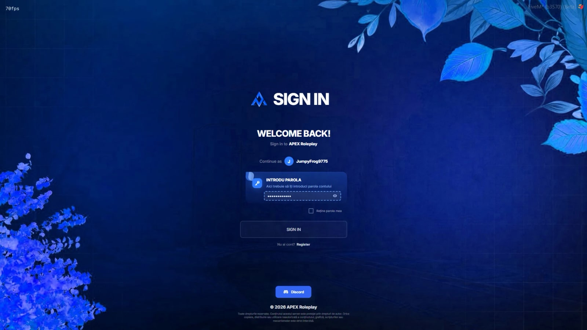
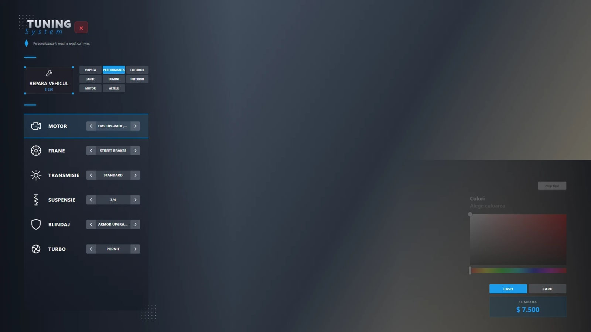
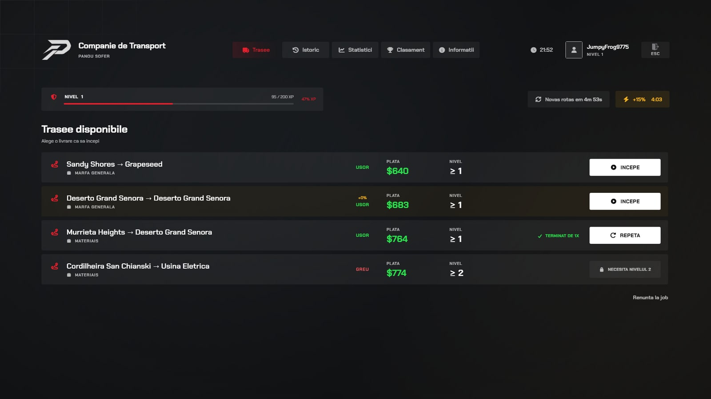
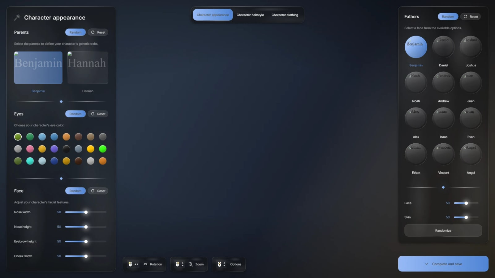

# Pulse Store

**Premium FiveM scripts, custom servers and Discord bots.**
Clean code, modern interfaces, real support.

[**Discord**](https://discord.gg/HmjEXhPF3Q) &nbsp;•&nbsp; [**Open a ticket to buy**](https://discord.gg/HmjEXhPF3Q)

> 🔒 This is a **showcase**. The source code of the products is private and is delivered only after purchase.

---

## Products

Every product has its own page with screenshots, the full feature list and compatibility.

<table>
  <tr>
    <td width="50%" align="center" valign="top">
       
      <a href="https://github.com/amiculap/pulse-login"><b>PULSE-LOGIN</b></a> 
      Login & register with account recovery 
      vRP · MongoDB 
      <b>5€</b>
    </td>
    <td width="50%" align="center" valign="top">
       
      <a href="https://github.com/amiculap/pulse-tuning"><b>PULSE-TUNING</b></a> 
      Full vehicle tuning with a live color picker 
      vRP · ESX · QBCore · standalone 
      <b>10€</b>
    </td>
  </tr>
  <tr>
    <td width="50%" align="center" valign="top">
       
      <a href="https://github.com/amiculap/pulse-trucker"><b>PULSE-TRUCKER</b></a> 
      Trucker job with dispatcher panel, XP and leaderboard 
      vRP · ESX · QBCore · Qbox · standalone 
      <b>25€</b>
    </td>
    <td width="50%" align="center" valign="top">
       
      <a href="https://github.com/amiculap/pulse-character"><b>PULSE-CHARACTER</b></a> 
      Identity registration + full character creator 
      vRP (bridge) · ESX · QBCore · standalone 
      <b>15€</b>
    </td>
  </tr>
</table>

Every product is tested, comes with support after purchase and free updates for bug fixes.

---

## Custom work

- **Custom FiveM server** — built from scratch or rewritten from an existing one (vRP, QBCore or ESX), with clean and optimized code.
- **Custom Discord bots** — made around your community, with no useless features.
- **Monthly maintenance** — bug fixing, optimization, backups and monitoring.

## How to buy

1. Join the [Discord server](https://discord.gg/HmjEXhPF3Q)
2. Open a ticket in **#tickets**
3. Tell us what you need and get the details
4. Pay and receive your files

Payments: bank transfer, Revolut, LTC, Paysafe.

---

© 2026 Pulse Store — all rights reserved. See [LICENSE](LICENSE).

